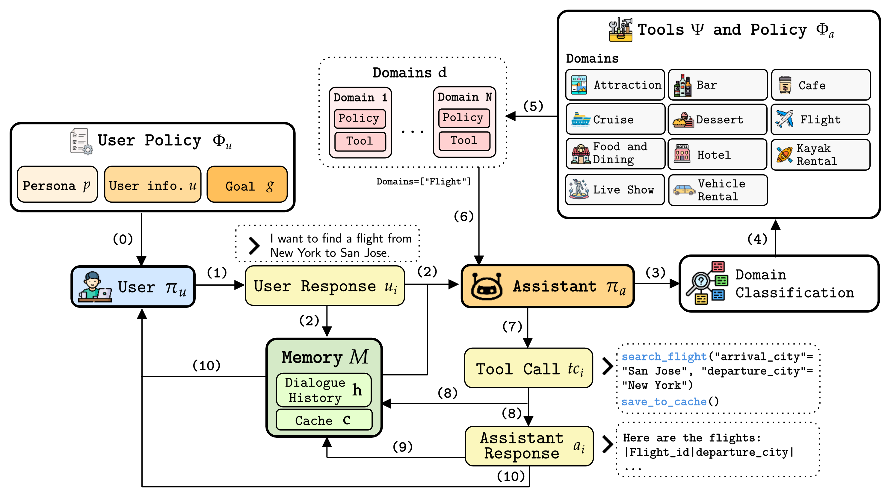
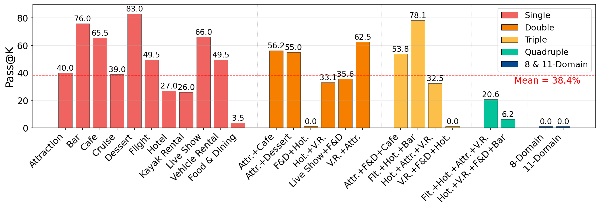
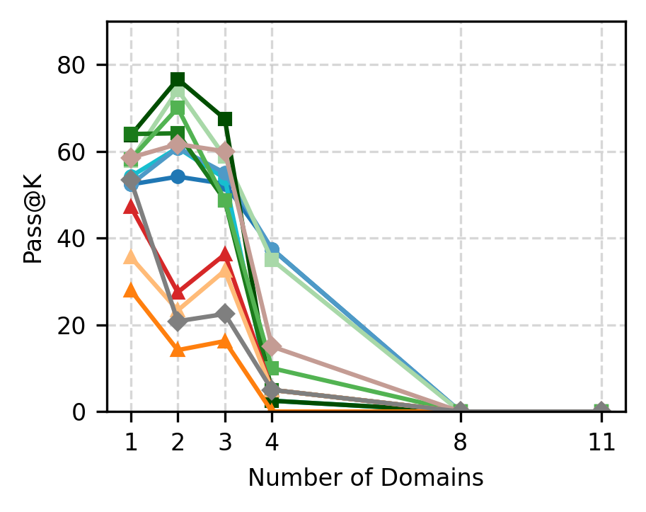
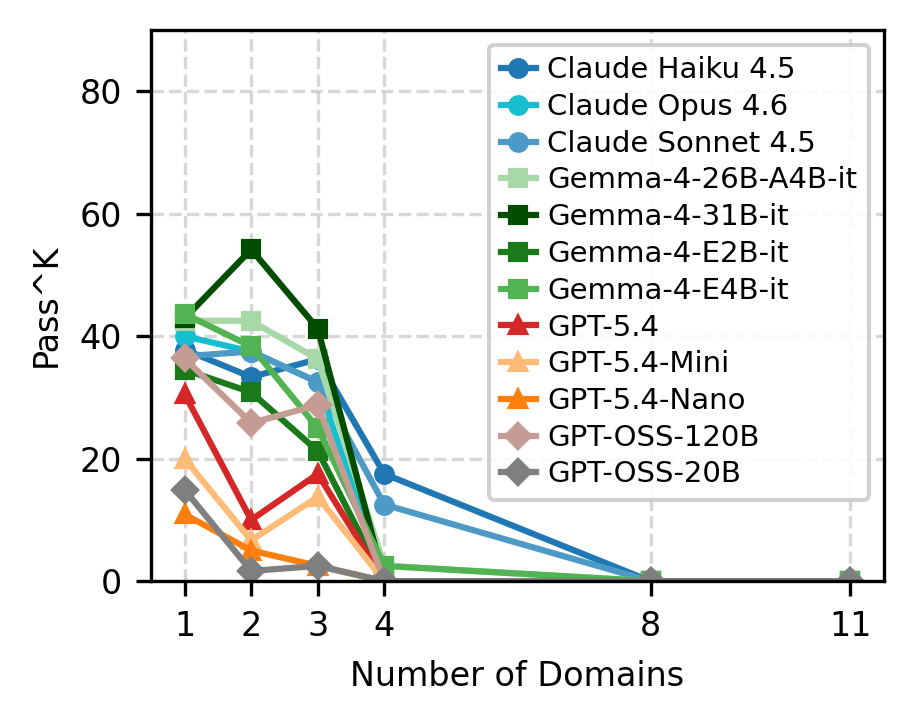
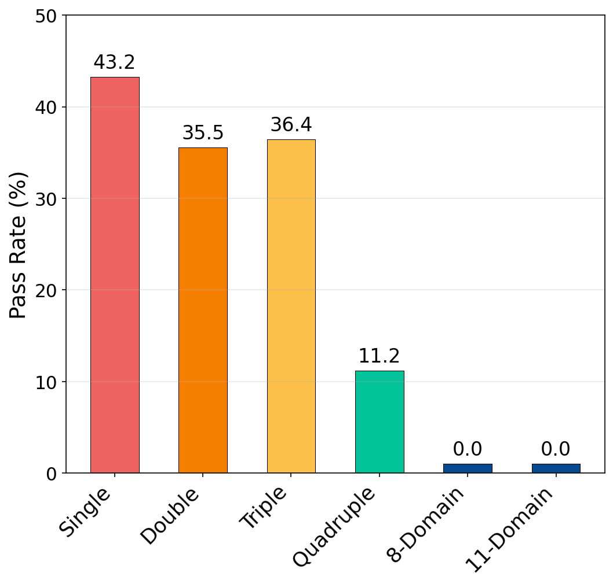

# T1-Bench: Benchmarking Multi-Scenario Agents in Real-World Domains

[](https://opensource.org/licenses/Apache-2.0)


---

**T1-Bench** is a benchmark for evaluating LLM agents across multi-turn, multi-domain real-world scenarios. Agents must search, filter, book, modify, and cancel across 11 domains, using only tool calls, with no hallucinated knowledge. The benchmark covers **76 tools**, **525 conversation templates**, and **11 single-domain + 14 multi-domain** configurations.



## Table of Contents
- [Domains](#-domains)
- [Installation](#-installation)
- [Running Experiments](#-running-experiments)
- [Evaluation](#-evaluation)
- [Results](#-results)
- [Supported Models](#-supported-models)
- [Key Arguments](#-key-arguments)
- [Repository Structure](#-repository-structure)
- [How to Contribute](#-how-to-contribute)
- [Citation](#-citation)
- [Contact](#-contact)

---

## 🌐 Domains

| Domain | Type | # Tools |
|---|---|---|
| Attraction | Single | 5 |
| Bar | Single | 5 |
| Café | Single | 6 |
| Cruise | Single | 5 |
| Dessert | Single | 8 |
| Flight | Single | 5 |
| Food & Dining | Single | 15 |
| Hotel | Single | 7 |
| Kayak Rental | Single | 6 |
| Live Show | Single | 7 |
| Vehicle Rental | Single | 5 |
| Attraction + Café | Double (2) | 11 |
| Attraction + Dessert | Double (2) | 13 |
| Food & Dining + Hotel | Double (2) | 22 |
| Hotel + Vehicle Rental | Double (2) | 12 |
| Live Show + Food & Dining | Double (2) | 22 |
| Vehicle Rental + Attraction | Double (2) | 10 |
| Attraction + Food & Dining + Café | Triple (3) | 26 |
| Flight + Hotel + Bar | Triple (3) | 17 |
| Vehicle Rental + Food & Dining + Hotel | Triple (3) | 27 |
| Vehicle Rental + Hotel + Attraction | Triple (3) | 17 |
| Flight + Hotel + Vehicle Rental + Attraction | Quadruple (4) | 22 |
| Vehicle Rental + Hotel + Food & Dining + Bar | Quadruple (4) | 32 |
| 8-Domain | 8-Domain (8) | 55 |
| 11-Domain (All Domains) | 11-Domain (11) | 74 |
| **Total** | -- | **76** |

---

## 📦 Installation

Requires Python 3.12+ and [uv](https://docs.astral.sh/uv/getting-started/installation/).

```bash
git clone <repo>
cd t1-bench-code

# Create a virtual environment pinned to Python 3.12
uv venv --python 3.12

# Activate it
source .venv/bin/activate

# Install the project in editable mode
uv pip install -e .

# Optionally, also install dev tools (pytest, ruff, coverage, ipdb)
uv pip install -e . --group dev
```

If you'd rather not activate the venv, prefix commands with `uv run`, e.g. `uv run python scripts/run_simulation.py ...`.

### Environment variables

Model calls are configured via environment variables loaded from a `.env` file at the repo root. Create one with the variables you need:

```bash
# .env
LLM_BASE_URL=<your OpenAI-compatible endpoint, e.g. an internal vLLM router>
LLM_API_KEY=<key for the endpoint above, if required>
OPENAI_API_KEY=<key, only needed when targeting OpenAI-hosted models>
GEMINI_API_KEY=<key, only needed when targeting Gemini models>
TOGETHER_API_KEY=<key, only needed when targeting Together AI models>
```

You only need to set the variables for the providers/models you're actually running against.

### Pointing at your own model server

The open-source models run through any **OpenAI-compatible** endpoint (e.g. a [vLLM](https://docs.vllm.ai/) server). Point the runner at yours by setting `LLM_BASE_URL` to its `/v1` URL (and `LLM_API_KEY` if it requires one), then pass the model ids your server actually serves:

```bash
export LLM_BASE_URL=http://<your-host>:8000/v1   # your vLLM / OpenAI-compatible server
export LLM_API_KEY=<key if required; omit otherwise>

python scripts/run_simulation.py --domain flight --conversation_id 1 \
    --user_model_name <model id your server serves> \
    --assistant_model_name <model id your server serves>
```

- **Provider is chosen by a substring of the model id** (`scripts/model_config.py`). An id containing `gemini`, `qwen`, or `gpt-` (but **not** `gpt-oss`) is routed to the corresponding **hosted** provider (Gemini / Together / OpenAI) and uses that provider's API key — *not* your `LLM_BASE_URL`. Ids containing `gemma`, `gpt-oss`, `nemotron`, or `llama`, and anything matching none of these, use the OpenAI-compatible path and your `LLM_BASE_URL`. So if a self-hosted model's id collides with a hosted-provider keyword (most commonly `qwen`), it will be sent to that provider instead of your server — rename it or serve it under an id that falls through to the default.

### Dataset

The domain data files (`data_attractions.csv`, `data_hotel.csv`, etc.) are **included in this repo** under [`datasets/`](datasets/) — no download is required to run the benchmark.

### User policy templates

The simulation also needs the **user-policy templates** — the persona/goal and benchmark success criteria that drive each conversation. They are published on the Hugging Face Hub in the [gentaiscool/test2](https://huggingface.co/datasets/gentaiscool/test2) dataset as one `.jsonl` file per domain / domain-combination (e.g. `liveshow.jsonl`, `multi_2domain_liveshow_food&dining.jsonl`).

1. Download the template `.jsonl` files from the Hub into a local folder (e.g. `output_jsonl/`):

   ```bash
   python scripts/download_dataset.py --repo-id gentaiscool/test2 --out-dir output_jsonl
   ```

2. Convert them into the `populated_*_user_policy_templates.json` layout the runner expects (point `--src` at the folder that actually holds the `.jsonl` files):

   ```bash
   python scripts/convert_templates.py --src output_jsonl

   # or point --src at wherever you downloaded them
   python scripts/convert_templates.py --src ~/Downloads/t1-bench-final/output_jsonl
   ```

This writes `data/user_policies/data/<domain>/populated_<domain>_user_policy_templates.json` for every single- and multi-domain configuration — the paths that `--templates` (and each domain's default) resolve to. The converter parses each record's `benchmark_success_criteria` into an object and assigns a 1-based `id` per entry. Pass `--dry-run` to preview the filename → destination mapping without writing, or `--force` to overwrite existing files.

---


## 🧪 Running Experiments

### Single domain

```bash
# Run one conversation
python scripts/run_simulation.py --domain flight --conversation_id 1 --assistant_model_name <configured_model_name>

# Run all conversations in a domain
python scripts/run_simulation.py --domain flight --conversation_id -1 --assistant_model_name <configured_model_name>
```

### Multi-domain

```bash
python scripts/run_simulation.py \
    --domain live_show food_and_dining \
    --templates data/user_policies/data/live_show_food_dining/populated_live_show_food_dining_user_policy_templates.json \
    --conversation_id 1
```

### Batch mode (parallel)

```bash
python scripts/run_simulation.py \
    --domain flight \
    --batch --start 1 --end 50 --parallel 4 \
    --assistant_model_name <configured_model_name>
```

### Full benchmark run

Set `MODEL_NAME` in `benchmark.sh` to your target model, then run:

```bash
LLM_BASE_URL="<LLM_BASE_URL>"                           
MODEL_NAME="<MODEL_NAME>" bash benchmark.sh    
```

The benchmark script runs all single and multi domain configurations with configurable concurrency.

---

## 📊 Evaluation

Each run produces a conversation JSON and a metrics JSON in `simulated_conversation/<model>/<domain>/`.

### Metrics

| Metric | Description |
|---|---|
| **Tool Call F1** | Precision/recall/F1 of predicted vs. gold tool calls |
| **Parameter F1** | Precision/recall/F1 of predicted vs. gold tool parameters |
| **Tool Output Exact Match** | Whether the tool returned the expected output given gold parameters |
| **Pass** | Combined pass/fail verdict per conversation |
| **LLM-as-Judge** | Helpfulness and Coherence scored 1 to 5 by an LLM judge |

### LLM-as-Judge rubric

Two criteria, each on a 1 to 5 Likert scale:

- **Helpfulness**: Are responses relevant, accurate, and actionable?
- **Coherence**: Does the conversation flow logically with consistent context?

---

## 🏆 Results

### Pass@K=3 per Domain

Pass@K measures the probability that at least one of K=3 independent trials succeeds. The overall average across all models and domains is 38.4%, with single-domain tasks scoring significantly higher than multi-domain configurations.



### Performance vs. Domain Complexity

Performance consistently degrades as the number of active domains increases — both Pass@K and Pass^K drop sharply beyond 3–4 domains, and all models record 0% on 8-domain and 11-domain settings.





### Average Pass@K by Domain Cardinality

Average Pass@K grouped by domain cardinality (single through 11-domain), showing the monotonic decline in task completion as compositional complexity grows.



---

## 💻 Supported Models

We evaluate T1-Bench using 12 proprietary and open-weight models. All user and judge agents are instantiated using GEMMA4-26B-A4B-IT.

### Open-Weight
- GPT-OSS 20B
- GPT-OSS 120B
- Gemma4-26B-A4B-IT
- Gemma4-31B-IT
- Gemma4-E2B-IT
- Gemma4-E4B-IT

### Proprietary
- Claude Haiku 4.5
- Claude Sonnet 4.5
- Claude Opus 4.6
- GPT-5.4-Nano
- GPT-5.4-Mini
- GPT-5.4

---

## ⚙️ Key Arguments

| Argument | Default | Description |
|---|---|---|
| `--domain` | required | Domain(s) to simulate |
| `--conversation_id` | `1` | Template ID to use; `-1` runs all |
| `--assistant_model_name` | `<configured_assistant_model_name>` | Model for the assistant role |
| `--user_model_name` | `<configured_user_model_name>` | Model for the simulated user role |
| `--max_turns` | `20` | Maximum turns per conversation |
| `--batch` | `false` | Launch parallel background runs |
| `--parallel` | `4` | Concurrency in batch mode |
| `--run_dir` | auto-timestamped | Output directory for results |

---

## 🗂️ Repository Structure

```
t1-bench-code/
├── scripts/
│   ├── run_simulation.py        # Main simulation + evaluation entry point
│   ├── conversation_generator.py
│   ├── eval_tool_conversations.py
│   ├── aggregate_metrics.py
│   └── rubric.json              # LLM-as-judge criteria
├── src/t1_plus_plus/
│   ├── ontology/                # Domain data models
│   ├── schema/                  # Tool input/output schemas
│   ├── tools/                   # Tool implementations (per domain)
│   └── utils/                   # Policy classifier, tool conversion
├── assets/                      # Figures and benchmark assets
├── benchmark.sh                 # Full benchmark runner
└── pyproject.toml
```

---

## 🚀 How to Contribute?

Feel free to create [an issue](https://github.com/CapitalOne-Research/t1-bench/issues) if you have any questions. And, create [a PR](https://github.com/CapitalOne-Research/t1-bench/pulls) for fixing bugs or adding improvements.

---

## 📄 Citation

If you use T1-Bench in your research, please cite the associated paper:

```bibtex
@article{winata2026t1,
  title={T1-Bench: Benchmarking Multi-Scenario Agents in Real-World Domains},
  author={Winata, Genta Indra and Chakraborty, Amartya and Lin, Yuzhen and Rao, Swasthi P and Siingh, Shikhhar and Lu, Houhan and Bathaee, Nadia and Hatwar, Sriharsha and Dashore, Paresh and Jain, Anmol and others},
  journal={arXiv preprint arXiv:2606.11070},
  year={2026}
}
```

---

## 📬 Contact

For questions or to discuss extensions of this work, reach out to reach out to [Genta Indra Winata](mailto:gentaindrawinata@gmail.com) and [Amartya Chakraborty](mailto:chakrab.amartya@gmail.com)
